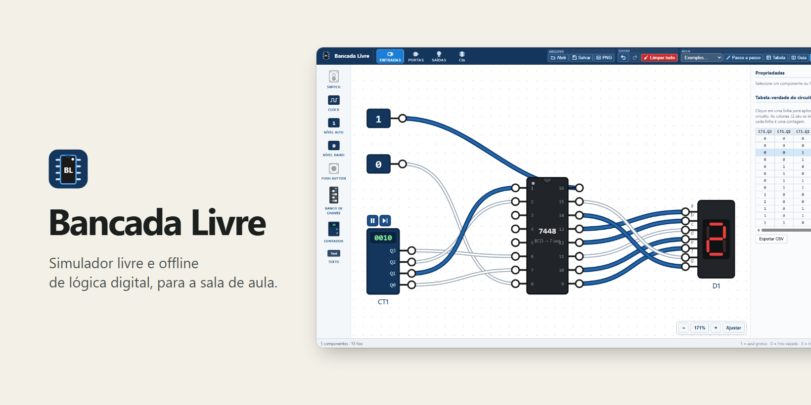
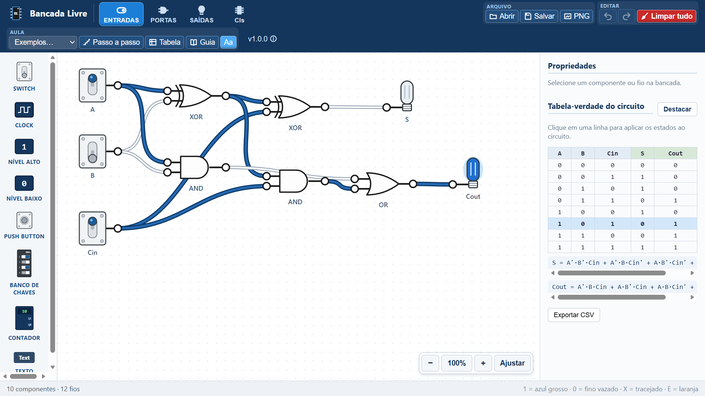
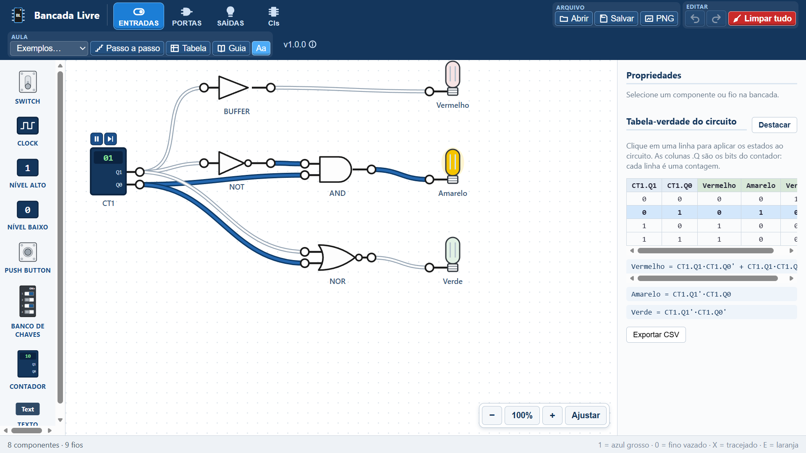
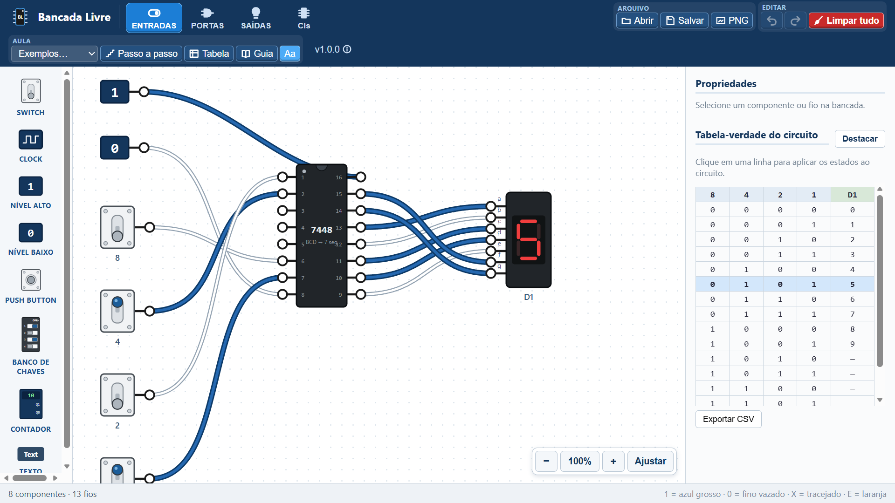
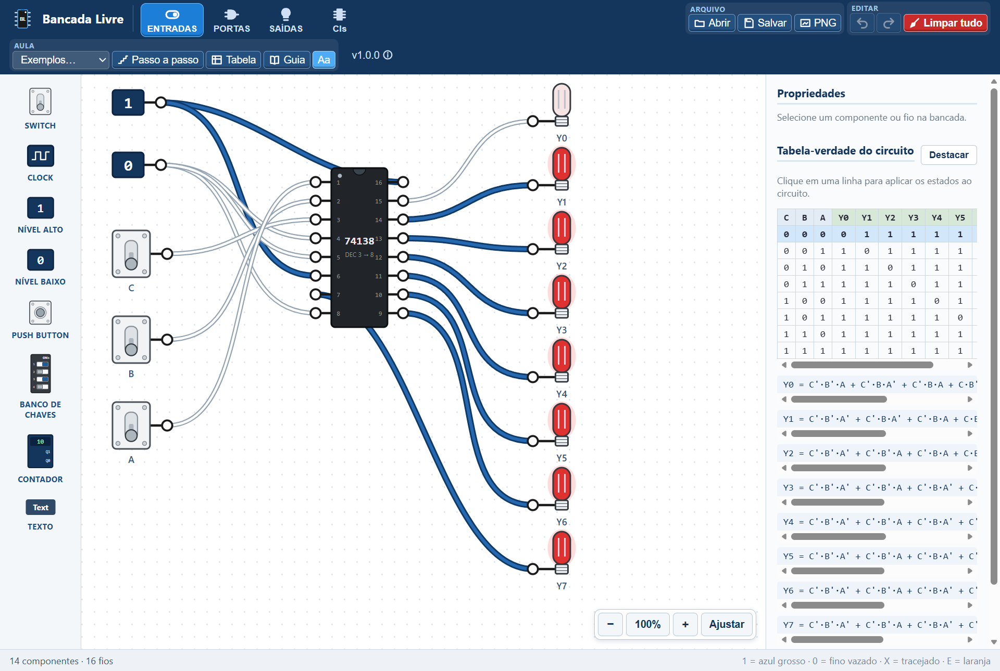

<!-- Bancada Livre · © 2026 Heraldo Antunes · SPDX-License-Identifier: MIT -->
<p align="center"></p>

<h1 align="center">Bancada Livre </h1>

<p align="center"><b>Simulador livre e offline de lógica digital, para montar e testar circuitos em sala de aula.</b><br>
O aluno liga chaves, portas, CIs 74xx, flip-flops, LEDs e displays e vê o sinal propagar na hora, com a
tabela-verdade e a expressão booleana do circuito inteiro. Livre, gratuito e sem internet.</p>

<p align="center">
  
  <a href="#sistemas"></a>
  
  <a href="LICENSE"></a>
  
  <br>
  <a href="https://github.com/HeraldoAntunes/bancada-livre/actions/workflows/testes.yml"></a>
  <a href="https://scorecard.dev/viewer/?uri=github.com/HeraldoAntunes/bancada-livre"></a>
  <a href="https://github.com/HeraldoAntunes/bancada-livre/releases/latest"></a>
  <a href="https://github.com/HeraldoAntunes/bancada-livre/releases"></a>
  <a href="https://doi.org/10.5281/zenodo.23696269"></a>
</p>

<p align="center">
  <a href="https://github.com/HeraldoAntunes/bancada-livre/releases/latest"><b>⬇ Baixar o Bancada Livre</b></a>
  &nbsp;·&nbsp; <a href="docs/GUIA-DE-USO.md">Guia de uso</a>
  &nbsp;·&nbsp; <a href="#programas-livres-">Programas Livres</a>
</p>

<p align="center"></p>

<p align="center">
  <a href="#qual-arquivo-baixar">Baixar</a> · <a href="#como-abrir">Como abrir</a> · <a href="#recursos">Recursos</a> ·
  <a href="#sistemas">Sistemas</a> · <a href="#perguntas-frequentes">Perguntas</a> · <a href="#programas-livres-">Programas Livres</a>
</p>

## Qual arquivo baixar?

Versão 2.0.1:

| Para quê | Baixar |
|---|---|
| **Instalar no computador (Windows)** | [**Instalar-BancadaLivre-2.0.1.exe**](https://github.com/HeraldoAntunes/bancada-livre/releases/download/v2.0.1/Instalar-BancadaLivre-2.0.1.exe) |
| Usar sem instalar (versão portátil, para pendrive) | [BancadaLivre-2.0.1-portatil.zip](https://github.com/HeraldoAntunes/bancada-livre/releases/download/v2.0.1/BancadaLivre-2.0.1-portatil.zip) |
| Qualquer sistema, sem instalar nada: abre no navegador | [BancadaLivre-2.0.1.html](https://github.com/HeraldoAntunes/bancada-livre/releases/download/v2.0.1/BancadaLivre-2.0.1.html) |

Se o Windows avisar "o Windows protegeu o computador", clique em **Mais informações → Executar assim mesmo** (o
programa é gratuito e não tem assinatura paga). Versões anteriores e a conferência dos arquivos ficam na
[página de versões](https://github.com/HeraldoAntunes/bancada-livre/releases).

- **Grátis e livre:** licença [MIT](LICENSE). Use, copie e distribua à vontade, inclusive em escolas e redes de ensino.
- **Sem internet, sem conta, sem anúncios:** os circuitos ficam só no seu computador.
- **Versão atual:** a da página de [Releases](https://github.com/HeraldoAntunes/bancada-livre/releases/latest); o que
  mudou em cada versão está nas [novidades](CHANGELOG.md).

> **Aviso:** projeto independente e voluntário, fornecido "no estado em que se encontra", **sem garantia de qualquer
> tipo**. As marcas citadas pertencem aos seus donos; o Bancada Livre é um projeto independente, sem vínculo com elas.

## Como abrir

1. Abra a página de **[downloads (Releases)](https://github.com/HeraldoAntunes/bancada-livre/releases/latest)**.
2. Baixe o arquivo que serve para você:

   | Arquivo | Para quem |
   |---|---|
   | **`Instalar-BancadaLivre-x.y.z.exe`** ⭐ | **quase todo mundo no Windows.** Dois cliques e "Avançar": cria o atalho no menu Iniciar, abre numa janela própria e não pede senha de administrador |
   | `BancadaLivre-x.y.z-portatil.zip` | quem quer levar num pendrive sem instalar: descompacte e abra `BancadaLivre.exe` |
   | `BancadaLivre-x.y.z.html` | qualquer sistema: abra com dois cliques no navegador. É um arquivo só, que dá para pôr no Moodle ou mandar por e-mail |
   | Código-fonte | só para quem vai estudar ou modificar o programa |

3. Abra pelo atalho **Bancada Livre** no Menu Iniciar (ou pelo arquivo HTML, no navegador).

Para conferir se o arquivo é legítimo, compare o SHA-256 com o `SHA256SUMS.txt` da mesma página (troque `x.y.z` pela
versão que baixou):
```bash
certutil -hashfile Instalar-BancadaLivre-x.y.z.exe SHA256
```

## Como é
| Somador completo com portas lógicas | Semáforo com contador e tabela-verdade |
|---|---|
|  |  |
| **Decodificador 7448 no display de 7 segmentos** | **Decodificador 74138 acendendo 8 LEDs** |
|  |  |

## Recursos
- **8 portas** no símbolo ANSI: AND, OR, NOT, NAND, NOR, XOR e XNOR, de 2 a 8 entradas, e o BUFFER.
- **Entradas:** chave (SWITCH), CLOCK de 0,5 a 10 Hz (com rodar, pausar e avançar meio período no próprio
  componente), NÍVEL ALTO (1), NÍVEL BAIXO (0), PUSH BUTTON, **banco de chaves** de 4 ou 8 posições e
  **contador automático** de 2 a 4 bits, que gera as combinações no ritmo escolhido.
- **Memória (aba MEMÓRIA):** flip-flops D, JK, T e SR, disparados na subida do clock, com PR e CLR, e a trava D
  (latch). Cada um mostra o valor que guarda.
- **Saídas:** LED (azul, vermelho, verde ou amarelo), **barra de LEDs** de 4 ou 8, display de 7 segmentos (BCD
  de 0 a 9, hexadecimal de 0 a F, ou segmento a segmento) e SONDA.
- **Fios que mostram o estado** pela cor e pela espessura: em 1, azul e grosso; em 0, cinza e fino. Estados 0, 1,
  X (indefinido, como uma entrada solta) e E (erro: duas saídas no mesmo ponto ou laço).
- **Tabela-verdade** automática de cada porta e do circuito, com os bits do contador como entradas. Clicar numa
  linha aplica aquela combinação ao circuito. Abaixo dela aparece a **expressão booleana**, e o botão **Destacar**
  abre a tabela numa janela grande, boa para projetar.
- **Mapa de Karnaugh** de 2 a 4 variáveis, com os grupos coloridos e a **expressão simplificada**.
- **Linha do tempo:** a onda de cada clock, chave, flip-flop e LED ao longo do tempo (diagrama de tempo).
- **Conferir com gabarito:** importe a tabela esperada em CSV e veja, linha a linha, onde o circuito bate ou não.
- **CIs da série 74xx** com a pinagem real e alimentação VCC e GND obrigatória, como na protoboard: 7400, 7402,
  7404, 7408, 7432, 7486, o decodificador 7448, o decodificador 74138, o multiplexador 74151, o somador de 4 bits
  74283 e os sequenciais 7474 (dois flip-flops D), 7476 (dois JK), 74161 (contador de 4 bits) e 74164
  (registrador de deslocamento de 8 bits). O **Guia de CIs** mostra a pinagem e dicas de bancada de cada chip.
- **Modo passo a passo:** o sinal avança uma porta de cada vez.
- **40 circuitos de exemplo** em cinco grupos (Básico, Intermediário, Avançado, Memória e CIs), da porta AND
  sozinha até o contador assíncrono com JK, o registrador de deslocamento e o contador 74161 no display.
- **Bancada confortável:** zoom no ponto do cursor, **Ajustar** para ver o circuito inteiro, espelhar e girar
  componentes, texto livre para anotar, nome das portas (`Aa`), desfazer e refazer.
- **Salvar e exportar:** salvamento automático, circuito em `.json`, imagem PNG ou SVG da bancada e tabela em CSV.
- **Agentes de IA:** cada ação do programa existe também como comando, para um agente de IA que controla o
  navegador usar o simulador sem clicar (ver [Para quem desenvolve](#para-quem-desenvolve)).

## Sistemas
| | Windows 11 | Linux | macOS |
|---|---|---|---|
| Instalador, atalho e janela própria | ✅ | não (use o HTML) | não (use o HTML) |
| Arquivo HTML no navegador | ✅ testado no Microsoft Edge | ⚠️ deve funcionar, não testado | ⚠️ deve funcionar, não testado |

O instalador e a versão portátil abrem o simulador numa janela própria do **Microsoft Edge** ou do **Google
Chrome**, um dos dois precisa estar instalado. O arquivo HTML funciona em navegadores atuais (Chrome, Edge, Firefox,
Safari); foi testado no Windows 11 com o Microsoft Edge. Em telas com menos de 1366 px de largura, a barra superior
passa a ocupar duas linhas.

## Atalhos de teclado
| Tecla | Ação | Tecla | Ação |
|---|---|---|---|
| `Ctrl+Z` / `Ctrl+Y` | desfazer / refazer | `Delete` | apagar o item selecionado |
| `E` | espelhar o componente selecionado | `R` | girar 90 graus |
| `Ctrl` e `+` / `Ctrl` e `−` | ampliar / reduzir | `Ctrl+0` | mostrar todo o circuito (Ajustar) |
| `→` ou `Espaço` / `←` (passo a passo) | próximo nível / nível anterior | `Home` / `Esc` (passo a passo) | reiniciar / sair |

Duplo clique num componente abre a janela de edição dele.

## Perguntas frequentes
**É de graça mesmo?** Sim. É software livre (licença MIT): pode usar, copiar, instalar em quantos computadores quiser e
distribuir.

**Precisa de internet?** Não. Tudo funciona offline, e o programa não acessa a internet em momento nenhum.

**Onde ficam os meus circuitos?** O circuito aberto fica guardado no próprio navegador (salvamento automático: fechar
a janela não perde o trabalho). Para guardar ou entregar, use **Salvar**, que baixa um arquivo `.json`; **Abrir**
carrega de volta.

**Posso pôr no Moodle ou mandar para os alunos?** Pode. O `BancadaLivre-x.y.z.html` é o simulador inteiro num arquivo
só: o aluno abre com dois cliques, sem instalar nada.

**O antivírus reclamou. É seguro?** Os arquivos passam pelo Microsoft Defender antes de cada publicação, e você pode
conferir o SHA-256 e a assinatura do Sigstore. Alertas de "editor desconhecido" acontecem porque não há assinatura
digital paga. Veja [SECURITY.md](.github/SECURITY.md).

**Tem flip-flop e memória?** Tem, desde a 2.0: flip-flops D, JK, T e SR, a trava D e os CIs 7474, 7476, 74161
e 74164, com a linha do tempo para ver o que acontece a cada pulso do clock.

**Posso usar na minha escola ou rede de ensino?** Pode, à vontade, mantendo o aviso de licença.

**Encontrei um erro ou tenho uma ideia.** Abra uma [issue](https://github.com/HeraldoAntunes/bancada-livre/issues/new/choose).

## Para quem desenvolve

TypeScript, React 18, SVG, Vite e zustand, com testes no Vitest. Precisa do Node.js.

```bash
npm install      # primeira vez
npm run dev      # abre em http://localhost:5173
npm test         # testes automáticos
npm run lint     # linter
npm run build    # gera dist/index.html, o arquivo único
```

Para entender o código, veja [docs/ARQUITETURA.md](docs/ARQUITETURA.md).

### Comandos (para agentes de IA)

Cada ação da tela existe também como comando, para um agente de IA que controla o navegador usar o simulador sem
clicar. No console do navegador, com o Bancada Livre aberto:

```js
bancadaLivre.listar()                                          // comandos, descrições e parâmetros
bancadaLivre.executar('componente.adicionar', { tipo: 'AND' }) // devolve { ok, resultado } ou { ok: false, erro }
bancadaLivre.executar('fio.ligar', { de: 'c1:out', para: 'c2:in0' })
bancadaLivre.executar('tabela.ler')
```

Montar e editar por comando entra no Desfazer, como pelo mouse; mexer nas chaves e no clock não entra. O registro
fica em `src/comandos.ts`.

## Privacidade

Tudo roda no seu computador. O circuito fica guardado só no navegador (salvamento automático) e nos arquivos que
você mesmo baixar. O simulador não envia nada pela internet, não usa contas nem login e não tem propaganda ou
rastreamento. O arquivo HTML traz uma política de segurança que bloqueia qualquer acesso à rede. O botão **Ver se
há versão nova**, na janela Sobre, só abre a página de versões no seu navegador quando você clica nele: o programa
não consulta a internet sozinho.

*This program will not transfer any information to other networked systems unless specifically requested by the user or
the person installing or operating it.*

## Contribuir
Sugestões e correções são bem-vindas. Veja [CONTRIBUTING.md](.github/CONTRIBUTING.md) e a política de segurança em
[SECURITY.md](.github/SECURITY.md).

## Como citar
Se usar o Bancada Livre num trabalho, artigo ou material didático, cite a versão usada. Os dados estão em
[CITATION.cff](CITATION.cff); no GitHub, o botão **Cite this repository** gera a referência pronta (APA ou BibTeX).
Cada versão fica arquivada no Zenodo com DOI. O DOI geral, que leva sempre à versão mais recente, é
[10.5281/zenodo.23696269](https://doi.org/10.5281/zenodo.23696269).

## Como foi feito

O Bancada Livre foi criado e dirigido por **Heraldo Antunes**, para as suas aulas. Foi feito com apoio de
**inteligência artificial** (Claude, da Anthropic, pelo Claude Code), usada como ferramenta: a ideia, os requisitos,
as decisões de didática, a revisão e a aprovação de cada versão são do autor. A mesma declaração aparece na janela
**Sobre** do programa, aberta pelo número da versão.

## Licença

Licença **MIT** (ver [LICENSE](LICENSE)): uso, cópia, modificação e distribuição livres, inclusive por outras
instituições de ensino, mantendo o aviso de autoria. As bibliotecas de terceiros e suas licenças estão em
[THIRD-PARTY-NOTICES.md](THIRD-PARTY-NOTICES.md).

### Autoria dos desenhos
Os símbolos das portas, os corpos dos componentes, os CIs, os ícones e a capa foram **desenhados para o Bancada
Livre**, como código SVG escrito no próprio projeto, e estão sob a mesma licença MIT. Nenhum desenho foi copiado de
outros programas ou pacotes de ícones. As portas seguem apenas a **convenção** dos símbolos distintivos (ANSI/IEEE
91), e a pinagem dos CIs segue as folhas de dados dos fabricantes; o desenho de cada componente é original.

## Programas Livres 

Programas gratuitos e de código aberto, feitos por um professor para as próprias aulas. Cada um funciona sozinho,
sem internet e sem conta.

| | Programa | Para que serve | Código | Baixar |
|---|---|---|---|---|
|  | **Giz Livre** | Lousa digital para dar aula com mesa digitalizadora, caneta, toque ou mouse | [GitHub](https://github.com/HeraldoAntunes/giz-livre) | [Baixar](https://github.com/HeraldoAntunes/giz-livre/releases/latest) |
|  | **Giz na Tela** | Escrever por cima de qualquer programa aberto no computador | [GitHub](https://github.com/HeraldoAntunes/giz-na-tela) | [Baixar](https://github.com/HeraldoAntunes/giz-na-tela/releases/latest) |
|  | **Bancada Livre** | **Simulador de lógica digital: portas, CIs 74xx, flip-flops e tabela-verdade · você está aqui** | [GitHub](https://github.com/HeraldoAntunes/bancada-livre) | [Baixar](https://github.com/HeraldoAntunes/bancada-livre/releases/latest) |
|  | **Tarja Livre** | Tarjar dados pessoais em PDF sem internet, de um jeito que a tarja não sai | [GitHub](https://github.com/HeraldoAntunes/tarja-livre) | [Baixar](https://github.com/HeraldoAntunes/tarja-livre/releases/latest) |
